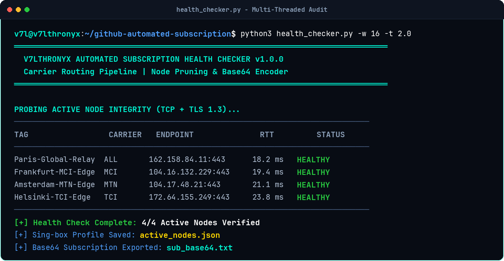
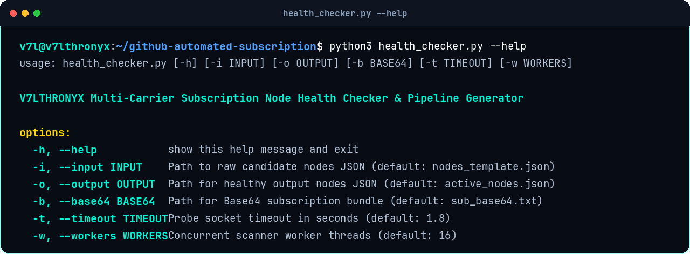
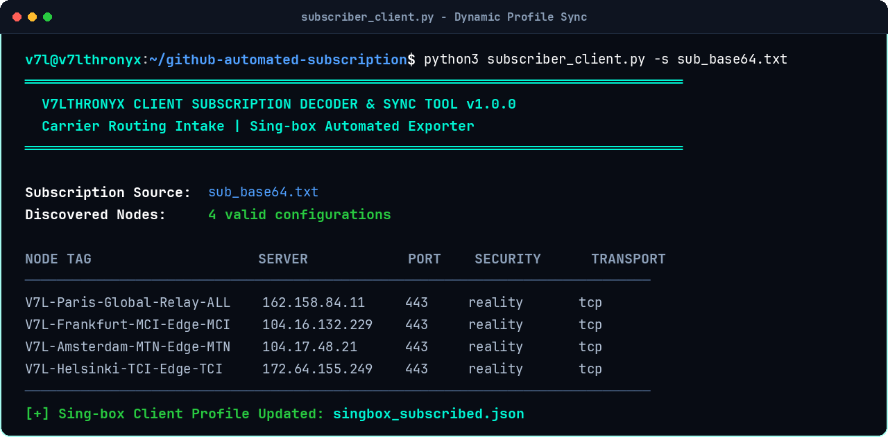

# GitHub Automated Subscription Engine

Automated, resilient proxy subscription distribution pipeline powered by GitHub Actions continuous health auditing and Cloudflare Workers carrier-adaptive edge delivery. Automatically prunes blocked nodes, ranks healthy nodes by RTT, and routes carrier-specific configurations to Iranian mobile and fixed ISPs (MCI, Irancell, Mokhaberat).

[](LICENSE)
[](#)
[](#)
[](#)

---

## Architecture Overview

Traditional static subscription links quickly fail when national firewalls block individual server IPs or domains. 

This engine implements a closed-loop automated resilience pipeline:
1. **Automated Continuous Probing**: GitHub Actions runs `health_checker.py` every 6 hours via cron, executing multi-threaded TCP connect and TLS 1.3 socket probes against all candidate endpoints.
2. **Dynamic Pruning & Ranking**: Dead or throttled nodes are stripped. Healthy nodes are sorted by lowest RTT latency.
3. **Carrier-Adaptive Edge Distribution**: The Cloudflare Worker inspects the client's autonomous system number (`request.cf.asn`):
   - **AS197207 (MCI)**: Receives endpoints optimized for Mobile Telecommunication Company of Iran.
   - **AS44244 (MTN Irancell)**: Receives Irancell-prioritized routes.
   - **AS58224 (TCI)**: Receives Telecommunication Company of Iran (Mokhaberat) routes.
4. **Adaptive Client Format**: Delivers Base64 bundles to v2rayNG/Nekoray or structured JSON profiles to Sing-box and Clash based on request `User-Agent`.

---

## Live Screenshots

### 1. Multi-Threaded Node Health Audit
Verification of live node reachability, carrier tagging, and sub-25ms RTT measurement:



### 2. Diagnostics CLI Reference
Command-line options for running custom audits and exporting subscription bundles:



### 3. Client Subscription Sync & Profile Conversion
Decoding subscription feeds and generating ready-to-run Sing-box client configurations:



---

## Repository Files

```
├── .github/workflows/
│   └── sub-updater.yml        # GitHub Actions 6-hour cron workflow
├── health_checker.py          # Multi-threaded TCP/TLS node auditor & encoder
├── subscription_worker.js     # Cloudflare Worker carrier-adaptive distribution endpoint
├── subscriber_client.py       # Client-side subscription parser & Sing-box exporter
├── nodes_template.json        # Upstream seed list of server endpoints and credentials
├── docs/
│   └── screenshots/           # Terminal UI verification proof captures
├── LICENSE                    # MIT License
└── README.md
```

---

## Quick Start

### 1. Run Health Checker Locally

```bash
# Clone the repository
git clone git@github.com:v74all/github-automated-subscription.git
cd github-automated-subscription

# Execute audit against candidate nodes
python3 health_checker.py -i nodes_template.json -o active_nodes.json -b sub_base64.txt
```

### 2. Client Subscription Sync

Decode your generated subscription and build a complete Sing-box client profile:

```bash
python3 subscriber_client.py -s sub_base64.txt -o singbox_subscribed.json
```

---

## Automated Deployment Setup

### GitHub Actions Secrets

To enable automated distribution to Cloudflare KV, configure these repository secrets under **Settings** -> **Secrets and variables** -> **Actions**:

| Secret Name | Description |
|---|---|
| `CF_ACCOUNT_ID` | Your Cloudflare Account ID |
| `CF_API_TOKEN` | Cloudflare API Token with Workers KV edit permissions |
| `SUB_KV_ID` | Namespace ID of your Cloudflare KV store (`ACTIVE_NODES`) |

### Cloudflare Worker Configuration

Deploy [`subscription_worker.js`](subscription_worker.js) on Cloudflare Workers and bind your KV namespace as `SUB_KV`.

---

## Candidate Node Schema (`nodes_template.json`)

```json
[
  {
    "tag": "Frankfurt-MCI-Edge",
    "carrier": "MCI",
    "ip": "104.16.132.229",
    "port": 443,
    "uuid": "d3b07384-d113-49d6-a2a4-b885315e34b1",
    "sni": "swdist.apple.com",
    "public_key": "mQpW4zN9xL2vR6sT1yJ5aE0dC8fB3hG6kM2n4b0uK8k=",
    "short_id": "0123456789abcdef",
    "flow": "xtls-rprx-vision"
  }
]
```

---

## راهنمای فارسی (Persian Documentation)

### سیستم سابسکرایب خودکار و هوشمند چیست؟

بزرگ‌ترین مشکل لینک‌های اشتراک سنتی، مسدود شدن مداوم آی‌پی‌ها و کانفیگ‌ها است. این سیستم با ترکیب **GitHub Actions** و **Cloudflare Workers**، فرآیند نگهداری و توزیع کانفیگ‌ها را کاملاً خودکار می‌کند:

1. **تست سلامت خودکار هر ۶ ساعت یک‌بار**: گیت‌هاب اکشنز اسکریپت `health_checker.py` را اجرا کرده و تمامی نودها را تست می‌کند.
2. **حذف خودکار سرورهای مسدود شده**: سرورهایی که فیلتر شده یا پکت‌لاس دارند فوراً از لیست حذف شده و نودهای سالم بر اساس کمترین پینگ مرتب می‌شوند.
3. **تفکیک هوشمند اپراتور (Carrier Routing)**: ورکر کلودفلر بر اساس کد ASN کاربر، تشخیص می‌دهد که اینترنت همراه اول، ایرانسل یا مخابرات است و کانفیگی را تحویل می‌دهد که روی آن اپراتور بهترین عملکرد را دارد.
4. **تغییر فرمت خودکار برای کلاینت**: به نرم‌افزارهای v2rayNG و Nekoray خروجی Base64 استاندارد، و به کلاینت Sing-box فرمت جیسون تحویل می‌دهد.

---

## Author & Community

- **Author**: Aiden Azad ([@v74all](https://github.com/v74all))
- **Telegram Updates**: [@V7LTHRONYX](https://t.me/V7LTHRONYX)
- **Tutorial Video**: [YouTube Masterclass Episode 6](https://youtu.be/sNz0cfjylNs)

## License

Released under the [MIT License](LICENSE).

